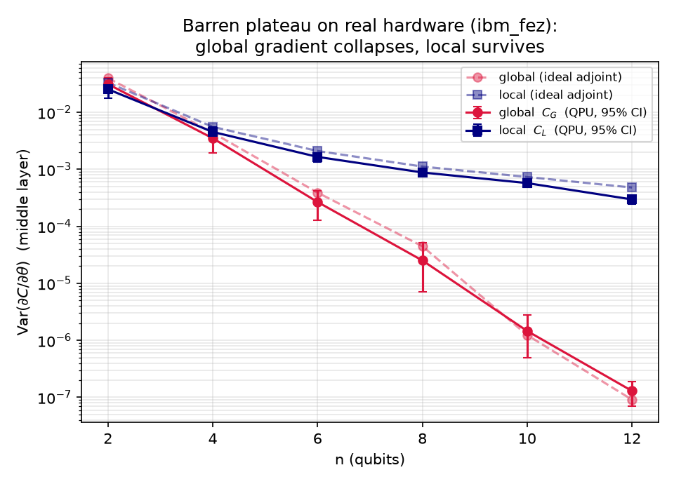

# NeuraQ

- **Event:** Qiskit Fall Fest Hackathon 2026, IISER Bhopal
- **Track:** Quantum Machine Learning (Problem 04: Quantum Neural Network avoiding barren plateaus)
- **Team Name:** NeuraQ
- **Team Members:** Soumyadeep Chakraborty, Janmay Tyagi, Stottra Roy, Abhinav Sharma

## Overview

In variational quantum machine learning, initializing deep parameterized circuits with random angles leads to exponentially vanishing gradient variances as qubit count increases. This barren plateau phenomenon makes gradient-based optimization intractable, as shot noise drowns out the directional signal.

NeuraQ provides a dual contribution:
1. **Empirical Benchmarking on Physical QPUs:** We measure gradient variance scaling across circuit widths ($n = 2$ to $12$) comparing global and local cost observables on exact statevector simulations, noisy Aer device models, and IBM Quantum's 156-qubit `ibm_fez` processor.
2. **Pre-Flight Trainability Screening Tool:** A diagnostic CLI (`neuraq screen`) that assesses gradient variance decay rates and suggests mitigations (such as operator locality changes or initialization schemes) before users consume QPU queue time.



*Figure 1: Gradient variance on IBM Quantum's `ibm_fez` (Eagle r3, 156 qubits) for global vs local cost functions (Experiment E15). While global cost variance collapses rapidly (~ factor of 4 per added qubit), local cost retains orders-of-magnitude stronger gradient signal (reaching a ~2300x advantage at $n=12$).*

## Environment Setup

Tested on Python 3.14.7 (Windows 11). Standard CPython environment without external GPU requirements.

```bash
python -m venv .venv
.venv\Scripts\activate          # on Linux/macOS: source .venv/bin/activate
pip install -r requirements.txt
```

*Note: An IBM Quantum account is only required to submit new QPU jobs. All data processing, simulation suites, and unit tests run entirely offline without credentials.*

## Quickstart & Reproducibility

### 1. Main Result Simulation (~1 to 3 minutes)
Runs the cost locality comparison on the batched NumPy statevector simulator:
```bash
python experiments/e2a_cost_locality.py
```

### 2. Regenerate Physical Hardware Figures
Rebuilds the hero hardware figure from the committed job results:
```bash
python scripts/plot_main_result.py      # n = 2 to 12 -> outputs figures/main_result.png
```

### 3. Run Test Suite (~1 to 2 minutes)
Executes all 127 verification tests checking gradients against finite-difference and analytic baselines:
```bash
python -m pytest -q
```

### 4. Interactive Trainability Screen CLI
Diagnose any ansatz before submitting expensive QPU jobs:
```bash
python neuraq_cli.py screen --n 8 --depth 4 --cost global
```
Sample output:
```text
NeuraQ trainability screen
  configuration  : n=8  depth M=4  cost=global  init=random  topology=line
  gradient var   : 4.821e-05
  decay slope    : -1.22 / qubit  (n=8 -> n=10)
  verdict        : BARREN PLATEAU
  mitigation     : local cost gives 1.735e-03  (36x more signal)
  primary fix    : local_cost
    -> suggested : cost=local init=random M=4 n=8
```

### 5. Submitting New IBM Quantum Hardware Runs (Optional)
Requires an IBM Quantum token set in the environment (`export QISKIT_IBM_TOKEN="your_token"` or via `IBMQ_TOKEN`):
```bash
python experiments/e15_hardware.py --backend least_busy --shots 512 --r 48 --ns 2 4 6 8
```

## Physical Hardware Benchmark Details

- **Backend:** IBM Quantum `ibm_fez` (156-qubit Eagle r3 processor).
- **Execution Dates:** 2026-10-13 (jobs created 23:05–23:13 IST) and 2026-10-18 (16:33 & 16:38 IST).
- **Verified Job IDs (all `DONE`):**
  - $n \in \{2, 4, 6, 8\}$: `db76ns2raffc73f9s62g`, `db76pn8r1c5c738js3hg`, `db76qfqraffc73f9sb60`, `db76rl6r6oqs7386spt0`
  - $n \in \{10, 12\}$: `dbaaf77i0auc7391nsog`, `dbaah9fi0auc7391nuq0`
  - Full raw bitstrings and execution metadata: [`results/e15_qpu_jobs.json`](results/e15_qpu_jobs.json).
- **Configuration:** Circuit depth $M = 4$, 512 shots per circuit, single-axis all-RY hardware-efficient ansatz, target state $|0\dots0\rangle$, parameter-shift gradient evaluated on the central layer. Widths $n \in \{2,4,6,8,10\}$ used $R = 48$ random initializations; $n = 12$ used $R = 32$ within available free-tier QPU allocations.
- **Statistical Processing:** Slopes and variance values include bootstrap 95% confidence intervals. Fixed random seeds (e.g. `seed = 2026`) ensure deterministic reruns.

## Repository Structure

### Library: `bpqnn/`

| Module | Description |
|---|---|
| `simulator.py` | Vectorized NumPy statevector simulator (single-axis layered ansatz, CZ chain) |
| `ansatz.py` | Parameter tensor reshaping, entangling topologies, Qiskit QuantumCircuit export |
| `costs.py` | Global and local objective functions, state fidelity calculations |
| `grad.py` | Adjoint differentiation and analytic parameter-shift gradients |
| `init.py` | Random, identity-block, and perturbed-identity parameter initialization |
| `observables.py` | Tunable-support observable measurements (block and windowed readouts) |
| `hamiltonian.py` | Transverse-field Ising Hamiltonian construction and ground state solver |
| `train.py` | Adam, layerwise Adam, and classical L-BFGS-B optimization routines |
| `shots.py`, `noise.py` | Shot-noise estimators and batched density-matrix simulation routines |
| `mps.py`, `sqd.py` | Matrix Product State decomposition, Schmidt spectra, and sample-based SQD |
| `classify.py` | Binary QNN classifier benchmark (additive and parity classification tasks) |
| `csa.py` | Cost-Support Annealing and bounded local-to-global convex schedules |
| `hardware.py` | Hardware circuit compilation, execution, and parameter-shift parsing |
| `screen.py` | Diagnostic trainability screening core engine |
| `reference.py` | Analytic reference statevector calculations |

### Key Experiments: `experiments/`

| Script | Investigation |
|---|---|
| `e1_plateau.py` | Empirical gradient variance decay across width and depth |
| `e2a_cost_locality.py` | Global vs local cost variance scaling (core mitigation) |
| `e2b_init_layerwise.py` | Identity-block initialization and layerwise training |
| `e3_training.py`, `e4_shot_training.py` | Parameter optimization under equal budget and shot noise |
| `e6_classify.py` | Classification benchmark over cost locality and initialization choices |
| `e7_nibp.py` | Noise-induced barren plateaus across gate depolarizing levels |
| `e8_sqd.py`, `e9_mps.py` | Sample efficiency of SQD/QSCI and MPS surrogate modeling |
| `e10_decoder.py`, `e12a`, `e12b` | Quantum error correction decoders (Repetition, Steane, Surface codes) |
| `e11_support_radius.py` | Gradient variance vs support radius of observable operators |
| `e13_csa.py` | Support scheduling (Cost-Support Annealing) |
| `e14_ctqd.py` | Classical surrogate pre-training deployed to quantum circuits |
| `e15_hardware.py` | Hardware validation on IBM Quantum processor `ibm_fez` |
| `e16_screen.py` | Command-line diagnostic screening workflow |
| `e17_parity_task.py` | Expressivity trade-off: parity tasks inaccessible to local readouts |
| `e18_screen_validation.py` | Empirical validation of trainability screening predictions |
| `e19_lambda_mix.py` | Bounded convex combinations of local and global cost functions |
| `e20_perturbed_init.py` | Perturbed identity initialization restoring edge-layer gradient signals |

## Methodological Limits & Negative Findings

- **Simulation Scope:** Benchmarks utilize exact NumPy statevectors, Qiskit Aer noiseless simulation, Aer with the FakeBrisbane noise model ($n \le 8$), and real IBM Quantum hardware ($n \le 12$).
- **Characterization Focus:** This toolkit measures trainability and gradient landscape decay; it does not claim quantum computational advantage or superiority over classical ML architectures.
- **Classical Baselines:** Energy minimization is checked against exact numerical diagonalization and L-BFGS-B; classification tasks are evaluated on held-out test sets.
- **Cost-Support Annealing (E13):** Linear support schedules provide modest trainability benefits; however, complex variance-gated schedules did not consistently outperform static local objectives.
- **Optimizer Dynamics at Finite Widths (E3, E18):** Although gradient variance vanishes exponentially, Adam's per-parameter adaptive normalization enables convergence at moderate widths ($n = 8$), demonstrating that barren plateaus manifest as severe optimization slowdowns rather than strict impossibility barriers at small scales.
- **Screening Calibration:** Screen diagnostic thresholds were calibrated against baseline sweeps and serve as variance indicators rather than absolute training outcome predictors.

## AI Assistance Note

See [`AI_USE_NOTE.md`](AI_USE_NOTE.md) for tool usage details, error identification, and verification procedures in accordance with hackathon guidelines.

## Primary References

- McClean et al., *Nat. Commun.* 9, 4812 (2018): Barren plateaus in quantum neural network training landscapes.
- Cerezo et al., *Nat. Commun.* 12, 1791 (2021): Cost function-dependent barren plateaus in shallow quantum neural networks.
- Grant et al., *Quantum* 3, 214 (2019): An initialization strategy for addressing barren plateaus in parameterized quantum circuits.
- Skolik et al., arXiv:2006.14904: Layerwise learning for quantum neural networks.
- Wang et al., *Nat. Commun.* 12, 6961 (2021): Noise-induced barren plateaus in variational quantum algorithms.
- Jones and Gacon, arXiv:2011.02991: Efficient calculation of gradients in classical simulations of variational quantum algorithms.
