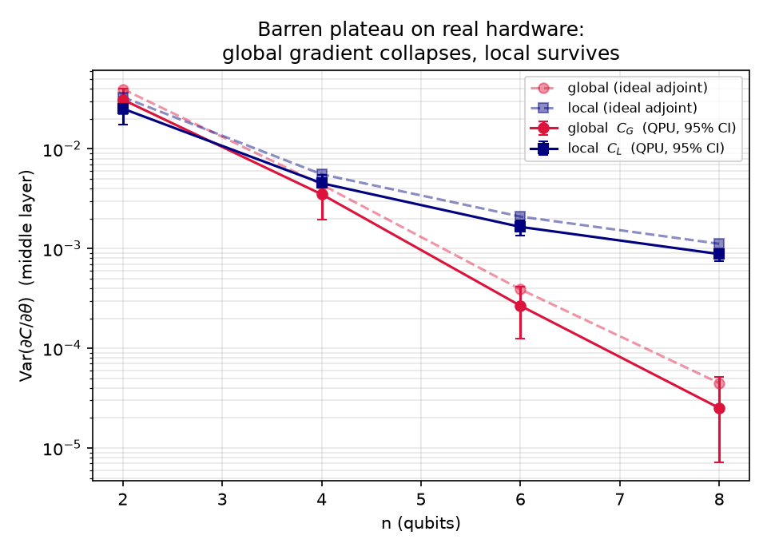
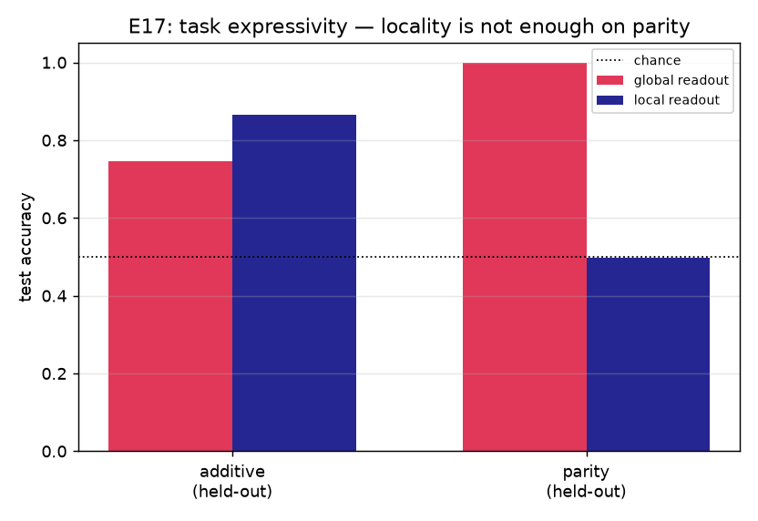
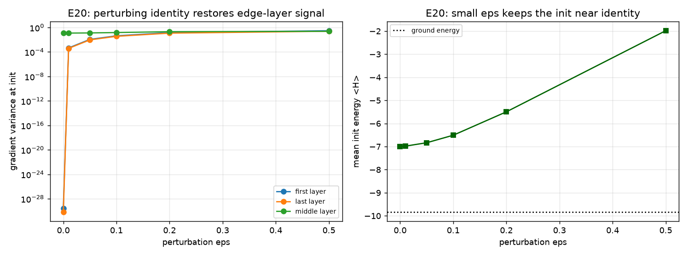

# NeuraQ — measuring and mitigating barren plateaus on real quantum hardware

NeuraQ · Qiskit Fall Fest 2026

## Problem

Variational quantum neural networks (QNNs) are trained by estimating the
gradient of a cost function with respect to the circuit parameters. For deep,
randomly initialised circuits that gradient vanishes **exponentially** with the
number of qubits: the *barren plateau*. This is not merely "small gradients".
At a plateau a fixed number of gradient measurements carries an exponentially
vanishing amount of information about the cost, so adding shots or iterations
buys nothing and training stalls. The failure mode is precisely the regime
people want: deep, expressive circuits trained on a global cost.

The goal of NeuraQ is a **measured, error-barred** comparison of what actually
controls the plateau — the locality of the cost function and the standard
mitigations — validated not only in an ideal simulator but also under device
noise and on a real IBM Quantum processor. Success means a reproducible,
honest number, not an advantage claim.

## Method

**Simulator.** The core is a batched NumPy statevector simulator (little-endian
basis, matching Qiskit). Gradients use reverse-mode **adjoint differentiation**
and are validated three ways: against parameter-shift, against finite
differences, and against Qiskit Aer (E0). The ansatz is a single-axis layered
hardware-efficient ansatz, `R_1 E R_2 E … E R_M`, with a CZ chain, the standard
structure used to exhibit plateaus.

**Protocol.** For the target `|0…0>` we use two costs on the same circuit:

- global (faithful): `C_G = 1 − P(0…0)`, an observable acting on all qubits;
- local: `C_L = 1 − (1/n) Σ_i P_i(0)`, a sum of single-qubit observables.

We estimate `R` random initialisations and report `Var(∂C/∂θ)` over the middle
layer, with **bootstrap 95% confidence intervals**, and fit the decay as a
log-linear slope per qubit. `C_L` and `C_G` obey `C_L ≤ C_G ≤ n·C_L`, which
turns the trainable local cost into a bound on the faithful global one (E19).

**Mitigations evaluated on equal footing.** Local cost (E2a); identity-block and
**perturbed-identity** initialisation (E2b, E20); layerwise training (E2b);
support scheduling / Cost-Support Annealing (E13); and a **bounded local→global
λ-mix** schedule (E19). A **trainability screen** packages the same measurement
as a pre-flight verdict (E16, E18).

**Beyond the ideal simulator.** We repeat the measurement with a **FakeBrisbane
device-noise model** in Aer, and once on real hardware: IBM Quantum `ibm_fez`,
`n ∈ {2,4,6,8}`, depth `M = 4`, `R = 48` inits, `512` shots (jobs `db76ns2raf…`,
`db76pn8r…`, `db76qfqr…`, `db76rl6r…`, all `DONE`, 2026-10-13). All simulator
results are exact; the QPU variances include shot noise and are reported as
such. Exact diagonalisation and an L-BFGS-B oracle give classical references for
the energy tasks.

## Results

**The plateau, and the locality lever, on real hardware.** The hero figure
(`figures/main_result.png`) shows gradient variance versus width for the global
and local costs. The global-cost variance collapses by roughly `4^-n`; the
local-cost variance decays far more slowly.

| n | global Var (sim) | global Var (noise) | global Var (QPU) | local Var (QPU) | local / global (QPU) |
|---|---|---|---|---|---|
| 2 | 4.0e-2 | 3.4e-2 | 3.1e-2 | 2.5e-2 | 1.2 |
| 4 | 4.4e-3 | 3.3e-3 | 3.5e-3 | 4.5e-3 | 0.8 |
| 6 | 3.9e-4 | 2.7e-4 | 2.7e-4 | 1.7e-3 | 6.2 |
| 8 | 4.7e-5 | 3.0e-5 | 2.5e-5 | 8.8e-4 | 35 |

The fitted slopes are: ideal simulation global `−1.16`, local `−0.55` per qubit;
device-noise global `−1.21`, local `−0.56`; real hardware global `−1.20`, local
`−0.55`. The full-window simulator sweep (E2a, `R = 512`, `n = 2…12`) gives
global `−1.27` (95% CI `[−1.34, −1.22]`) and local `−0.45` (`[−0.449, −0.443]`).
At `n = 8` the local/global gap is `≈25×` in the ideal simulation, `≈31×` under
device noise, and `≈35×` on the QPU. Noise shrinks both variances (the signal
never grows) but leaves the slopes intact: **the hardware data is consistent
with the noise model, and the locality gap is at least as large as simulated,
with overlapping confidence intervals.**

**Locality is not expressivity.** A subtler and cleaner result (E17): on the
additive task (E6) the local readout wins (`0.87` vs `0.75` held-out accuracy),
but on a **parity** task the local readout is provably unable to represent the
label — it scores chance (`0.50`) — while the global readout solves it exactly
(`1.00`, held-out). So "use a local cost" is not a free win: the trainable cost
is the one that can express the target, which is why the harness must expose
both.

**Support radius (E11).** Generalising beyond binary local/global, gradient
variance decays approximately exponentially in the observable's support: adding
one qubit of support multiplies the variance by `≈ 1/2^(κ)` with `κ ≈ 1.6–2.0 ×
ln 2` for `n = 6…12`. This predicts noise tolerance directly from an
observable's support.

**A bounded schedule (E19).** The `λ`-mix cost `(1−λ)C_L + λC_G` was tested with
`λ` ramped 0→1. The normalisation bound `C_L ≤ C_G ≤ n·C_L` holds empirically
(max violation 0; max ratio `C_G/C_L = 2.8 ≤ n`). Under both exact and
Adam-normalised shot gradients all arms reach a low global cost; the blend is
never *worse* than the global cost and always starts on the trainable surface.

**Perturbed identity (E20).** The exact identity block leaves the first and last
layers with essentially no gradient signal at initialisation (first-layer
variance `≈ 2.6e-30`). Perturbing every angle by `U(−ε, ε)` restores it
(`4.6e-4` at `ε = 0.01`, `1.5e-1` at `ε = 0.2`) while keeping the initial energy
near the identity value.

**Screening (E16/E18).** The screen separates widths cleanly (slope `−1.27` per
qubit; recommends a local cost with a `≈37×` variance improvement), but its
verdict is a gradient-*variance* alarm, not an optimiser-failure predictor at
these widths (see limits).

## Honest limits

- **What is simulated.** Exact noiseless NumPy statevector; Qiskit Aer
  noiseless; Aer with a **FakeBrisbane** device noise model — *not* `ibm_fez`
  specifically; and one real QPU run at small scale.
- **No advantage claim.** NeuraQ characterises trainability. It does not claim
  quantum advantage, speed-up, or a better classifier.
- **The plateau does not always block optimisers.** With Adam's per-parameter
  normalisation the global-cost arm can still reach a low cost at `n = 8`
  (E3), and even under shot noise every configuration in the `n ≤ 10` screen
  validation reached a low cost (E18). The screen's "barren" verdicts were
  **false negatives** there (TN = 0, FN = 3). The plateau is real and
  measurable as vanishing gradient *variance*, but at these widths it slows
  training rather than stopping it.
- **Relative, not asymptotic.** The local-cost slope (`≈ −0.55` per qubit) is
  still exponential over `n = 2…8`; the claim is that it decays far more slowly
  than the global one, not that it is polynomial.
- **Weak results kept.** Cost-Support Annealing (E13) is partial: the linear
  schedule helps, the staged and variance-gated variants do not beat the plain
  global cost. The E11 averaged cost carries a `1/W` normalisation that produces
  a mild non-monotonic shoulder at `r = 1,2`.
- **Classical baseline.** Energy tasks are checked against exact
  diagonalisation and an L-BFGS-B oracle, and the classifier against a
  **held-out** split; a matched-parameter-count classical MLP is the top
  remaining item and is not yet included.
- **Thresholds.** The screen's verdict thresholds were calibrated on the same
  sweeps it is judged against (E18).
- **Shot noise.** The E15 hardware variances include shot noise; the backend
  name, date and job IDs are recorded in the README.

## AI-use note

Coding agents (opencode CLI) gave **mild assistance only** — scaffolding,
boilerplate, docstrings, and running the test suite. One bug the team flagged
and had fixed: the classifier's MSE gradient had the wrong sign (`-2(y - p)`
instead of `mean(-2(y - base) * 0.5 * (C(theta + pi/2) - C(theta - pi/2)))`),
which had flipped an earlier "local cost worse" conclusion; it was caught by the
finite-difference check (agreement ~2e-10). Full note in `AI_USE_NOTE.md`.
