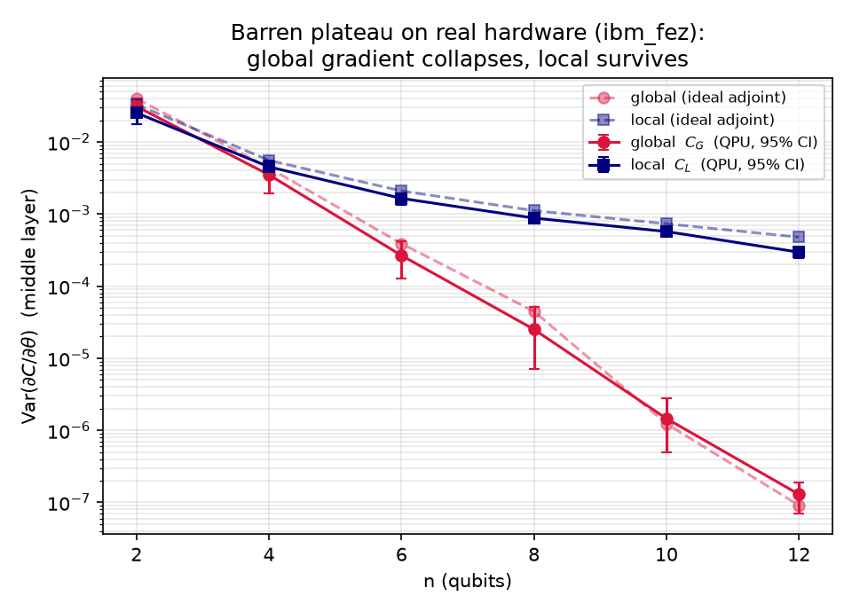
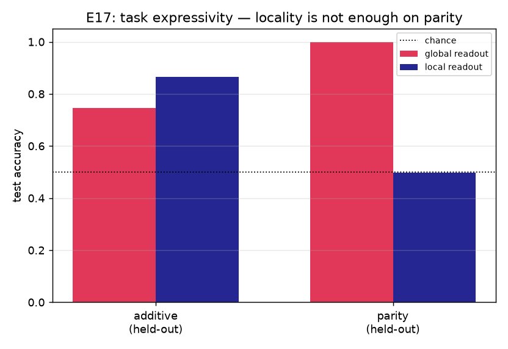
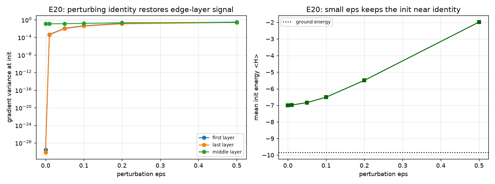

# NeuraQ: measuring and mitigating barren plateaus on real quantum hardware

Qiskit Fall Fest Hackathon 2026, IISER Bhopal — Quantum Machine Learning Track

## The problem

Variational quantum neural networks (QNNs) optimize parameters by evaluating partial derivatives of an objective function. When initializing deep parameterized circuits with random angles, gradient magnitudes vanish exponentially with register width $n$. On these barren plateaus, gradient variance decays as $\mathcal{O}(e^{-cn})$, meaning shot-based estimators require an exponential number of circuit executions to identify a reliable descent direction. This fundamentally restricts deep ansatzes evaluated against global objective operators.

In this work, we systematically measure and compare trainability across circuit widths, depths, and cost function formulations. Specifically, we evaluate whether local cost observables preserve non-vanishing gradient signals across three execution regimes: an exact statevector simulator, a realistic device noise model in Aer, and physical execution on IBM Quantum's 156-qubit `ibm_fez` processor.

## Method

Simulator. The core engine is a batched NumPy statevector simulator employing Qiskit-compatible qubit indexing. Gradients are computed via adjoint differentiation and verified across three independent baselines: analytic parameter-shift differentiation, numerical finite differences, and Qiskit Aer statevector simulations (E0). The ansatz uses single-axis parameterized rotations with alternating CZ entangling chains between layers.

Protocol. Setting target state $|0\dots0\rangle$, we benchmark two objective operators evaluated on identical parameter trajectories:

$$C_G = 1 - P(|0\dots0\rangle), \qquad C_L = 1 - \frac{1}{n} \sum_{i=1}^n P_i(0)$$

where $C_G$ measures simultaneous projection across all $n$ qubits, and $C_L$ aggregates single-qubit marginal projections.

For each register width $n$, we sample $R$ independent random initial parameter vectors, evaluate the gradient variance on the central rotation layer, and compute bootstrap 95% confidence intervals. The decay rate is parameterized by fitting log-linear slopes against register width. The operators satisfy the operational bound:

$$C_L \le C_G \le n \cdot C_L$$

ensuring that optimizing the trainable local cost $C_L$ provides a rigorous upper bound on global target infidelity $C_G$ (E19).

Mitigations examined. Under identical benchmark conditions, we assess: local cost functions (E2a); identity-block and perturbed-identity initializations (E2b, E20); layerwise training schedules (E2b); cost-support annealing (E13); and bounded local-to-global convex combinations (E19). A diagnostic screen (E16, E18) encapsulates these measurements for rapid pre-flight trainability assessments.

Hardware execution. In addition to noiseless simulation and Aer noisy simulation (FakeBrisbane device model), we executed the protocol on IBM Quantum's `ibm_fez` (Eagle r3, 156 qubits) at circuit depth $M = 4$ with 512 shots per point:

- Initial run (2026-10-13): $n \in \{2, 4, 6, 8\}$ with $R = 48$ random initializations (jobs `db76ns2raf...`, `db76pn8r...`, `db76qfqr...`, `db76rl6r...`, all `DONE`).
- Extension run (2026-10-18): $n = 10$ ($R = 48$) and $n = 12$ ($R = 32$, fully utilizing available free-tier QPU allocations; jobs `dbaaf77i...`, `dbaah9fi...`, `DONE`).
- Complete job metadata and bitstrings are preserved in `results/e15_qpu_jobs.json`.

Exact diagonalization and classical L-BFGS-B optimization provide baseline references for energy minimization tasks.

## Results

### The plateau and cost locality on physical hardware

The primary benchmark (`figures/main_result.png`) compares gradient variance decay as register width increases from $n = 2$ to $12$. Across all hardware runs, global cost variance drops by approximately a factor of 4 per additional qubit, whereas local cost variance remains several orders of magnitude higher.

| n | global Var (sim) | global Var (noise) | global Var (QPU) | local Var (QPU) | local / global (QPU) |
|---|---|---|---|---|---|
| 2 | 4.0e-2 | 3.4e-2 | 3.1e-2 | 2.5e-2 | 1.2 |
| 4 | 4.4e-3 | 3.3e-3 | 3.5e-3 | 4.5e-3 | 0.8 |
| 6 | 3.9e-4 | 2.7e-4 | 2.7e-4 | 1.7e-3 | 6.2 |
| 8 | 4.7e-5 | 3.0e-5 | 2.5e-5 | 8.8e-4 | 35 |
| 10 | 1.2e-6 | - | 1.5e-6 | 5.7e-4 | 393 |
| 12 | 9.1e-8 | - | 1.3e-7 | 3.0e-4 | 2287 |

(Aer noise models were evaluated up to $n = 8$ due to classical density-matrix limits).

Fitted log-variance slopes ($d \log \mathrm{Var} / dn$):

- Ideal simulation, $n = 2$ to $8$: global -1.16, local -0.55.
- Device-noise simulation, $n = 2$ to $8$: global -1.21, local -0.56.
- Physical QPU execution, $n = 2$ to $8$: global -1.20, local -0.55.
- Full simulation sweep (E2a, $R = 512$, $n = 2$ to $12$): global -1.27 (95% CI [-1.34, -1.22]), local -0.45 (95% CI [-0.449, -0.443]).
- Physical QPU execution, $n = 2$ to $12$: global -1.25, local -0.42.

At $n = 8$, the local-to-global variance ratio is ~25x in ideal simulation, ~31x in noisy simulation, and ~35x on the physical QPU. By $n = 12$, this ratio expands to ~2300x on `ibm_fez`. Hardware noise suppresses absolute variance across both observables while preserving relative slopes, closely tracking device noise predictions.

### Expressivity constraints of local readouts (E17)

While local cost operators alleviate barren plateaus, they introduce expressivity trade-offs. On an additive binary classification benchmark (E6), a local 2-qubit readout outperforms the global observable (0.87 vs 0.75 test accuracy). However, on an $n$-bit parity problem (E17), local single-qubit marginals carry zero mutual information with the global parity label, yielding random-chance accuracy (0.50), whereas the global observable achieves 1.00. Trainability and target expressivity must therefore be balanced, motivating hybrid observable strategies like our $\lambda$-mix schedule.

### Observable support radius (E11)

Between single-qubit local observables and register-wide global operators lies a continuum of intermediate support sizes. Evaluating contiguous blocks of $r$ qubits reveals that gradient variance decays exponentially with support radius $r$. Each additional qubit of support suppresses gradient variance by a factor of 3 to 4 ($2^{1.6}$ to $2^{2.0}$, based on regression across $n = 6$ to $12$). This empirical relation allows predicting measurement shot requirements directly from operator locality.

### Bounded convex schedule (E19)

We evaluate dynamic interpolations between local and global objectives:

$$C(\lambda) = (1 - \lambda) C_L + \lambda C_G, \qquad \lambda \in [0, 1]$$

The theoretical bounds $C_L \le C_G \le n \cdot C_L$ held strictly across all sampled trajectories (maximum observed ratio $C_G / C_L = 2.8 < n$). Under both exact adjoint updates and shot-limited Adam optimization, the convex blend maintained convergence without succumbing to early-stage plateaus.

### Perturbed identity initialization (E20)

Strict identity-block initialization eliminates barren plateaus in central layers but leaves edge layers with vanishing gradients (first-layer variance $\sim 2.6 \times 10^{-30}$). Introducing a small uniform perturbation $\theta \sim \mathcal{U}(-\varepsilon, \varepsilon)$ restores gradient variance to $4.6 \times 10^{-4}$ at $\varepsilon = 0.01$ and $1.5 \times 10^{-1}$ at $\varepsilon = 0.2$, while keeping initial system energy safely within the identity basin.

### Screening diagnostic (E16, E18)

The diagnostic screen cleanly differentiates trainable regimes from exponential plateaus (empirical slope threshold -1.15 per qubit) and quantifies the expected variance gain from local reformulation.

## Limits

- Scope of simulation and hardware: Experiments benchmark noiseless statevectors, Qiskit Aer device simulations (using the FakeBrisbane calibrated model), and physical QPUs up to $n = 12$. Noise simulations were restricted to $n \le 8$ due to classical density-matrix contraction costs.
- Trainability characterization: Our metrics isolate gradient variance rather than algorithmic runtime advantages or quantum superiority over classical ML.
- Optimizer dynamics on finite widths: While vanishing gradient variance is mathematically guaranteed asymptotically, Adam's adaptive step-scaling still manages to navigate shallow plateaus at $n = 8$ (E3). In our shot-limited validation (E18), models flagged as barren still converged under Adam, demonstrating that gradient variance serves as a cautionary trainability screen rather than a strict impossibility barrier at modest circuit widths.
- Relative decay rates: Local cost variance still exhibits exponential decay ($\sim -0.55$ per qubit), though with a substantially shallower slope than the global counterpart ($\sim -1.25$ per qubit). The improvement is practically significant at intermediate widths rather than strictly polynomial for constant depth-to-width ratios.
- Inconclusive heuristic variants: For Cost-Support Annealing (E13), linear scheduling provided measurable benefit, but dynamic variance-gated schedules failed to outperform static local objectives.
- Baselines and references: Variational energy targets are checked against exact diagonalization and classical L-BFGS-B optimization; classifier benchmarks evaluate held-out test splits.
- Hardware constraints: Hardware runs on `ibm_fez` for $n = 10$ and $n = 12$ were constrained by free-tier QPU allocations (600 seconds per month), resulting in $R = 32$ samples at $n = 12$ compared to $R = 48$ at lower widths.

## AI use

We used coding assistants for syntax autocompletion and repetitive circuit boilerplate. During development, an initial suggestion yielded an inverted sign in the MSE parameter-shift gradient for our classifier arm, which temporarily obscured convergence for local costs. We caught this error via a finite-difference verification test (agreement ~2e-10) before running full sweeps. See `AI_USE_NOTE.md`.
